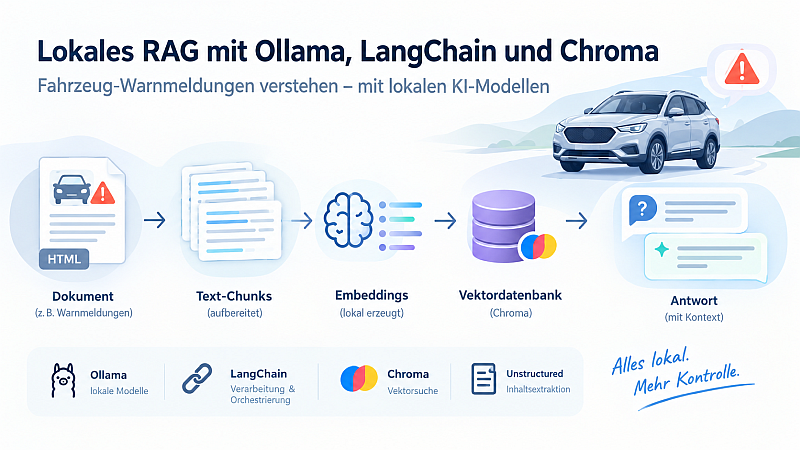

<!-- # Lokales RAG-Projekt für Fahrzeug-Warnmeldungen -->



Eine lokale Lernimplementierung von Retrieval-Augmented Generation (RAG):
Ein Sprachmodell beantwortet Fragen zu Fahrzeug-Warnmeldungen anhand eines
lokal gespeicherten HTML-Dokuments.

Das Projekt orientiert sich an einer DataCamp-Übung und ersetzt deren
OpenAI-Anbindung durch lokale Modelle über Ollama.

## Zweck des Projekts

Das Projekt dient dazu, die einzelnen Schritte einer RAG-Pipeline praktisch
zu verstehen und nachvollziehbar zu machen:

- Dokumente laden und ihren Inhalt extrahieren
- Text in kleinere Abschnitte (Chunks) aufteilen
- Embeddings lokal erzeugen
- Embeddings und Texte in einer Vektordatenbank speichern
- passende Textabschnitte zu einer Frage suchen
- Antworten anhand dieser Textabschnitte generieren
- Retrieval und Antworten anhand mehrerer Testfragen untersuchen

Nach der Installation der Abhängigkeiten und dem Herunterladen der Modelle
soll die Verarbeitung lokal erfolgen, ohne eine OpenAI-API zu verwenden.

## Aufgabenstellung

Ausgangspunkt ist eine HTML-Datei mit Warnmeldungen für einen MG ZS.

Die Anwendung soll eine Frage zu einer Warnmeldung entgegennehmen,
passende Abschnitte aus dem Dokument abrufen und daraus eine kurze
Antwort formulieren.

Eine Beispielanfrage lautet:

> The Gasoline Particular Filter Full warning has appeared.
> What does this mean and what should I do about it?

Das Modell soll ausschließlich Informationen aus dem bereitgestellten
Kontext verwenden. Falls dieser nicht ausreicht, soll es dies ausdrücklich
mitteilen.

## Erweiterungen gegenüber der ursprünglichen Übung

- Lokales Sprachmodell statt OpenAI-Chatmodell
- Lokale Embeddings statt OpenAI-Embeddings
- Persistente Chroma-Datenbank
- Protokollierung der Verarbeitungsschritte
- Frühe Verbindungs- und Modellprüfungen
- Ausgabe der abgerufenen Textabschnitte und ihrer Retrieval-Distanzen
- Testlauf mit mehreren Fragen
- JSON-Bericht mit Einstellungen und Ergebnissen

## Verwendete Komponenten

| Komponente | Aufgabe |
|---|---|
| Ollama | Lokaler Modellserver |
| llama3.2 | Generierung der Antworten |
| nomic-embed-text | Erzeugung der Embeddings |
| LangChain | Verbindung der Verarbeitungsschritte |
| Unstructured | Extraktion des Inhalts aus HTML |
| Chroma | Speicherung und Ähnlichkeitssuche der Textvektoren |
| Conda | Verwaltung der Python-Umgebung |
| pip | Installation der Python-Abhängigkeiten |

## Projektstruktur

```text
.
├── README.md
├── requirements.txt
├── .gitignore
├── src/
│   └── rag_ollama_test.py
├── data/
└── images/
```

Die Verzeichnisse `chroma_db/` und `test_report/` werden zur Laufzeit
angelegt und nicht versioniert.

## Voraussetzungen

- Conda
- Python 3.11 als vorgesehene Projektumgebung
- Ollama für das verwendete Betriebssystem
- Ausreichend freier Speicher für Modelle und Vektordatenbank

Installation von Ollama:
https://ollama.com/download

## Installation

### 1. Repository lokal öffnen

Das Repository klonen oder herunterladen und ein Terminal im
Projekt-Hauptverzeichnis öffnen.

### 2. Python-Umgebung erstellen

```bash
conda create -n rag-ollama python=3.11 -y
conda activate rag-ollama
```

### 3. Python-Abhängigkeiten installieren

```bash
python -m pip install -r requirements.txt
```

### 4. Modelle herunterladen

```bash
ollama pull llama3.2
ollama pull nomic-embed-text
```

### 5. Ollama prüfen

```bash
ollama list
```

Zusätzlich kann im Browser folgende Adresse geöffnet werden:

```text
http://localhost:11434
```

Wenn Ollama bereits im Hintergrund läuft, ist kein zusätzlicher
Aufruf von `ollama serve` erforderlich.


## Ausführung

Im Projekt-Hauptverzeichnis:

```bash
conda activate rag-ollama
python src/rag_ollama_test.py
```

Das Skript dokumentiert seine Verarbeitungsschritte im Terminal.

## Konfiguration

Die wichtigsten Einstellungen befinden sich im Skript:

```python
CHAT_MODEL = "llama3.2"
EMBEDDING_MODEL = "nomic-embed-text"

CHUNK_SIZE = 500
CHUNK_OVERLAP = 50
RETRIEVER_K = 3
```

Für Experimente möglichst nur einen Parameter pro Vergleichslauf ändern.

## Ergebnisse und Qualitätsprüfung

Das Skript zeigt:

- die generierte Antwort,
- die als Kontext übergebenen Textabschnitte,
- die zugehörigen Chroma-Distanzen,
- den technischen Status der Testfragen.

Ein kleinerer Distanzwert bedeutet größere Ähnlichkeit innerhalb der
verwendeten Suche. Er ist keine Wahrscheinlichkeit dafür, dass die
Antwort korrekt ist.

Der Status `OK` bedeutet lediglich, dass der Aufruf ohne Ausnahme
abgeschlossen wurde. Er bestätigt nicht die fachliche Richtigkeit
der Antwort.

Für eine inhaltliche Bewertung werden die Antworten mit dem
Originaldokument verglichen:

1. Wurde der richtige Abschnitt gefunden?
2. Sind alle Aussagen durch den Kontext belegt?
3. Fehlen wichtige Bedingungen oder Handlungsschritte?
4. Gibt das Modell bei fehlender Information eine Unsicherheit an?

Die angezeigten Quellen sind die dem Modell übergebenen Textabschnitte.

## Generierte Dateien

- `chroma_db/`: lokale Vektordatenbank
- `test_report/rag_test_report.json`: Bericht des letzten Testlaufs

Im aktuellen Skript wird die aktive Chroma-Collection vor der erneuten
Indexierung zurückgesetzt.

Der JSON-Bericht wird beim nächsten Lauf überschrieben, sofern kein
anderer Dateiname konfiguriert wird.

## Grenzen und Sicherheit

Dies ist ein Lernprojekt, kein verlässliches Fahrzeug-Diagnosesystem.

Sprachmodelle können trotz passendem Kontext falsche oder unvollständige
Antworten erzeugen. Bei realen Fahrzeug-Warnmeldungen sind das offizielle
Handbuch und qualifizierte Fachkräfte maßgeblich.

## Herkunft

Die Aufgabenidee stammt aus einer DataCamp-Lernübung. Dieses Repository
dokumentiert eine eigene lokale Anpassung zu Lernzwecken und ist kein
offizielles DataCamp-Projekt.

